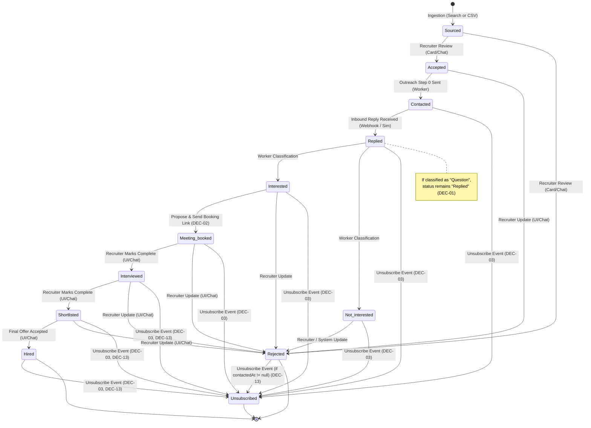

# Candidate Pipeline State Machine

- **Purpose**: Formal definition of candidate lifecycle states, transition guards, trigger actors, and unsubscribe safety rules.
- **Status**: Final
- **Last updated**: 2026-11-13

---

## 1. State Machine Diagram

---

## 2. Allowed Transition Matrix

| From Status | Allowed Target Status | Trigger Actor | Trigger Event / Action | Side Effects & Validations |
|---|---|---|---|---|
| *(Initial)* | `Sourced` | Worker / System | Search completed or CSV uploaded | Candidate scored (0–100); activity log recorded. |
| `Sourced` | `Accepted` | Recruiter (UI or Agent) | Clicks "Accept" on card or chats "accept top 5" | Candidate becomes eligible for outreach campaigns. |
| `Sourced` | `Rejected` | Recruiter (UI or Agent) | Clicks "Reject" on card or chats rejection | Candidate excluded from outreach. |
| `Accepted` | `Contacted` | Worker (Outreach) | BullMQ worker dispatches Step 0 email | `OutreachMessage` logged; sets `candidate.contactedAt = now` (DEC-13). |
| `Accepted` | `Rejected` | Recruiter (UI or Agent) | Recruiter changes decision before send | Candidate excluded from future campaign runs. |
| `Contacted` | `Replied` | Worker / Inbound | Inbound email or `POST /simulate-reply` | `outreachStopped=true`; cancels pending BullMQ sequence steps. |
| `Contacted` | `Unsubscribed` | Inbound / Recruiter | Reply class `Unsubscribe` or opt-out | Triggers **Unsubscribe Protocol** (see Section 3). |
| `Replied` | `Interested` | Worker (LLM) | Reply classified as `Interested` or `Wants a meeting` | Status advances to `Interested`. Follow-up or booking proposal created. |
| `Replied` | `Not interested` | Worker (LLM) | Reply classified as `Not interested` | Outreach remains halted; closing reply draft prepared. |
| `Replied` | `Replied` | Worker (LLM) | Reply classified as `Question` | Status remains `Replied` (DEC-01); grounded FAQ draft prepared. |
| `Replied` | `Unsubscribed` | Inbound / Worker | Reply classified as `Unsubscribe` | Triggers **Unsubscribe Protocol** (see Section 3). |
| `Interested` | `Meeting booked` | Recruiter / Agent | Recruiter sends booking link card | Link sent to candidate; status transitions (DEC-02). |
| `Interested` | `Rejected` | Recruiter (UI or Agent) | Recruiter decides not to move forward | Terminal status update; activity log recorded. |
| `Interested` | `Unsubscribed` | Inbound / Recruiter | Opt-out after positive interest | Triggers **Unsubscribe Protocol** (see Section 3). |
| `Not interested` | `Rejected` | Recruiter / System | Negative classification confirmed | Terminal status update. |
| `Not interested` | `Unsubscribed` | Inbound / Recruiter | Opt-out request | Triggers **Unsubscribe Protocol** (see Section 3). |
| `Meeting booked` | `Interviewed` | Recruiter (UI or Agent) | Recruiter marks interview done via UI or chat | Status moves forward; unlocks `Shortlisted`. |
| `Meeting booked` | `Rejected` | Recruiter (UI or Agent) | Post-meeting rejection | Terminal status update. |
| `Meeting booked` | `Unsubscribed` | Inbound / Recruiter | Opt-out after booking | Triggers **Unsubscribe Protocol** (see Section 3). |
| `Interviewed` | `Shortlisted` | Recruiter (UI or Agent) | Recruiter marks candidate shortlisted | Added to job shortlist view. |
| `Interviewed` | `Rejected` | Recruiter (UI or Agent) | Recruiter rejects after interview | Terminal status update. |
| `Interviewed` | `Unsubscribed` | Inbound / Recruiter | Opt-out after interview (DEC-13) | Triggers **Unsubscribe Protocol** (see Section 3). |
| `Shortlisted` | `Hired` | Recruiter (UI or Agent) | Recruiter marks candidate hired | Success funnel count incremented; terminal state. |
| `Shortlisted` | `Rejected` | Recruiter (UI or Agent) | Offer declined or candidate rejected | Terminal status update. |
| `Shortlisted` | `Unsubscribed` | Inbound / Recruiter | Opt-out during offer/shortlist (DEC-13) | Triggers **Unsubscribe Protocol** (see Section 3). |
| `Hired` | `Unsubscribed` | Inbound / Recruiter | Opt-out post-hire (DEC-13) | Triggers **Unsubscribe Protocol** (see Section 3). |
| `Rejected` | `Unsubscribed` | Inbound / Recruiter | Opt-out post-rejection (DEC-13) | Allowed if `contactedAt != null`. Triggers **Unsubscribe Protocol**. |
| `Unsubscribed` | `Unsubscribed` | Any | Redundant unsubscribe trigger (DEC-13) | **Clean no-op** (no error, no duplicate activity log). |

---

## 3. Unsubscribed Safety Protocol (Decisions [DEC-03](../99-open-questions.md), [DEC-13](../99-open-questions.md))

Per **Decision [DEC-13](../99-open-questions.md)**, `Unsubscribed` is allowed from **ANY status** once the candidate has been contacted (`Contacted`, `Replied`, `Interested`, `Not interested`, `Meeting booked`, `Interviewed`, `Shortlisted`, `Hired`, and `Rejected` if `contactedAt` is set).

When triggered:
1. **No-Op for Already Unsubscribed Candidates**: If `candidate.status === "Unsubscribed"`, the service returns success immediately as a clean no-op without mutating state or creating duplicate `ActivityLog` entries.
2. **Preserve Prior History**: The candidate record copies `status` into `statusBeforeUnsubscribe` before updating `status = "Unsubscribed"`.
3. **Immediate Outreach Cancellation**: Sets `candidate.outreachStopped = true`.
4. **Queue Cancellation**: Emits a cancellation event to BullMQ to purge any delayed or scheduled follow-up steps for this `candidateId`.
5. **Audit Trail**: Writes an `ActivityLog` entry recording `{ actor: "system", action: "candidate_unsubscribed", previousStatus, newStatus: "Unsubscribed" }`.
6. **Irreversible Outreach Lock**: No future campaigns can enroll an unsubscribed candidate under any circumstances.

---

## 4. Inbound Reply Classification Behavior Matrix (Decision ADR-0009 & F2)

| Reply Class | Status Behavior | Draft & Card Generation | Outreach Cancellation |
|---|---|---|---|
| **`Interested`** | Transitions to `Interested` (via `Contacted` -> `Replied` -> `Interested`). | AI drafts an enthusiastic follow-up reply; proposal card (`reply_draft`) created awaiting recruiter approval. | All pending BullMQ sequence jobs cancelled; `outreachStopped = true`. |
| **`Question`** | Status stays `Replied` (**Decision DEC-01**). | AI drafts an answer using **ONLY stored job data** (`title`, `mustHaveSkills`, `niceToHaveSkills`, `location`, `remotePolicy`, `salaryRange`, `seniority`). If unknown, states recruiter will follow up. Proposal card (`reply_draft`) created. | All pending BullMQ sequence jobs cancelled; `outreachStopped = true`. |
| **`Wants a meeting`** | Status transitions to `Interested` if not already (`Contacted` -> `Replied` -> `Interested`). On confirmation: transitions to `Meeting booked` (**Decision DEC-02**). | Worker generates 24-byte hex `bookingToken` and creates pending `SEND_BOOKING_LINK` proposal (`booking_link` card). On confirm: sends email with absolute booking link `${env.PUBLIC_FRONTEND_URL}/mock-booking/${bookingToken}`. | All pending BullMQ sequence jobs cancelled; `outreachStopped = true`. |
| **`Not interested`** | Transitions to `Not interested` (via `Contacted` -> `Replied` -> `Not interested`). | A short, polite closing draft waits for recruiter approval via `reply_draft` card. | All pending BullMQ sequence jobs cancelled; `outreachStopped = true`. |
| **`Unsubscribe`** | Transitions to `Unsubscribed` (**Decision DEC-13**). Preserves `statusBeforeUnsubscribe`. | **No email is drafted**. Recruiter receives assistant text notification. | All pending BullMQ sequence jobs cancelled; `outreachStopped = true`. Irreversible lock. |

### 4.1. Reply Class "Question" (Decision [DEC-01](../99-open-questions.md))
- Candidate status remains **`Replied`**.
- The `replyClass` is saved on the `Reply` record as `"Question"`.
- The AI generates a tailored response draft answering the candidate's query.
- The draft is rendered on a `reply_draft` card and waits for human approval before sending (Decision [DEC-04](../99-open-questions.md)).

### 4.2. Reply Class "Wants a meeting" (Decision [DEC-02](../99-open-questions.md))
- The AI proposes a `booking_link` card with a `PendingAction`.
- When the recruiter confirms the action, the booking link is sent and candidate status transitions to **`Meeting booked`**.
- When the candidate subsequently accesses the mock slot picker and chooses an interview time:
  - The selected time is stored in `candidate.meetingSlot`.
  - An `ActivityLog` entry is appended with `{ action: "candidate_selected_slot", details: { slot } }`.
  - **The status does not change again**; it remains `Meeting booked`.

---

## 5. Transition Validation Guards

The backend service `CandidateStatusService.transition(candidateId, newStatus, actor)` enforces the following code-level invariants:
1. **No Skip Guards**: A candidate cannot transition directly from `Sourced` to `Interviewed` or `Hired` without passing intermediate stages (`Accepted`, `Contacted`).
2. **Outreach Prerequisite**: Only candidates with status `Accepted` and a non-empty `email` can be transitioned to `Contacted`.
3. **Terminal Immutability**: Candidates in `Hired` cannot be transitioned to any other status.
4. **Audit Requirement**: Every attempted transition (valid or rejected) generates an `ActivityLog` record.
